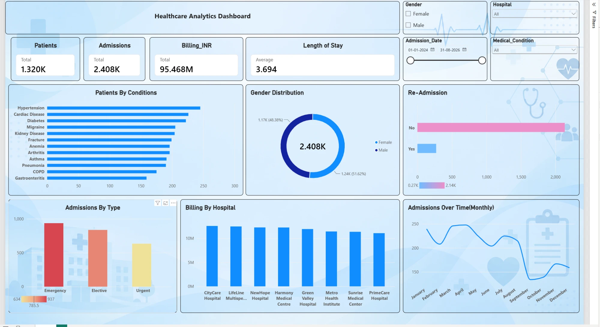

# Healthcare Analytics Dashboard (Power BI)

A one-page interactive Power BI dashboard analysing **2,408 hospital admissions** (Jan 2024 – Aug 2026) across 8 hospitals and 12 medical conditions. It covers patient volumes, billing, length of stay, readmissions and admission trends.

> **Note:** the dataset is **synthetic**, generated for practice (no real patient data).

## Built with
**Excel → Power BI.** The data was cleaned in Excel and modelled and visualised in Power BI. No SQL was used.

## Process
1. **Raw data.** `healthcare_powerbi_raw_dataset.csv` has 2,500 admissions and 28 columns covering patient details, admission and discharge dates, hospital, doctor, condition, vitals, billing, readmission and satisfaction.
2. **Cleaning (Excel).** I profiled the columns with pivot tables and removed **92 incomplete records** (61 missing BMI, 31 missing satisfaction score), leaving **2,408 admissions from 1,320 patients**.
3. **Modelling (Power BI).** I loaded the cleaned data and built the measures for the KPI cards.
4. **Dashboard.** I designed a single page with slicers for **Gender, Hospital, Admission Date and Medical Condition**.

## What the dashboard shows
| KPI | Value |
|---|---|
| Patients | **1,320** |
| Admissions | **2,408** |
| Total billing | **₹95.47M** |
| Average length of stay | **3.69 days** |

**Visuals:** patients by condition (Hypertension highest), gender split, 30-day readmissions (~11% readmitted), admissions by type (Emergency > Elective > Urgent), billing by hospital, and monthly admissions over time.

## Files
| File | Description |
|---|---|
| `Healthcare Dashboard.pbix` | The Power BI report |
| `healthcare_powerbi_raw_dataset.csv` | The raw dataset (before cleaning) |
| `screenshots/dashboard.webp` | A screenshot of the dashboard |

Open the `.pbix` in **Power BI Desktop** to explore it.
